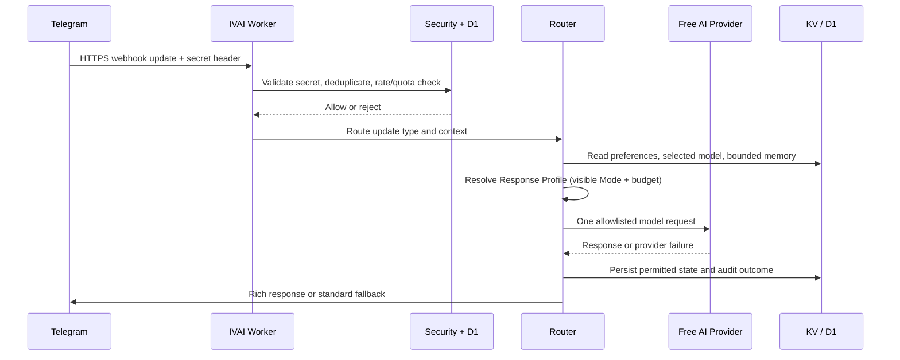

# IVAI v3.3 Architecture

IVAI is a single Cloudflare Worker that receives Telegram updates over a secret-protected webhook, processes each user request through a small set of focused ES modules, and persists state in Workers KV and D1. The architecture prioritizes predictable free-tier consumption: the normal response path makes one model request, and only tries the next configured free provider after a failure.

## Runtime components

| Component | Responsibility | State or boundary |
|---|---|---|
| `index.js` | Worker fetch entry point and scheduled handler | Rejects invalid webhook calls before routing; runs bounded background batches. |
| `security.js` | Webhook validation, update deduplication, rate/quota checks, roles | D1-backed atomic runtime guards. |
| `router.js` | Commands, callbacks, text/media updates, inline, Guest, reactions | Selects the minimum path necessary for each update. |
| `response-profile.js` | Authoritative response-mode contract | Resolves the visible Mode, instruction, bounded output budget, temperature, Workers AI reservation and Rich Math eligibility. Auto remains Auto and never silently becomes Fast/Deep/Code. |
| `ai.js` | Provider execution, prompt assembly, sequential fallback | Consumes one Response Profile per turn; Workers AI primary; allowlisted free providers only. |
| `catalog.js` | Free-model catalog and picker | KV cache; selected model validation. |
| `telegram.js` | Telegram API calls, Rich Draft/Message fallback, UI and context forwarding | Preserves business and topic identifiers. |
| `storage.js` | User preferences, conversations, tasks, delivery state, audit data | D1 for relational state, KV for bounded memory/cache. |
| `media.js` | Telegram file retrieval, transcription, image analysis | Enforces size and quota limits before AI processing. |
| `broadcast.js` | Draft, preview, confirmation, queue and sequential deliveries | D1 audit trail; no paid broadcast flag. |
| `secretary.js` | Due-task claiming and reminder delivery | Atomic D1 claim prevents duplicate reminders. |
| `reengagement.js` | Consent-aware inactive-user check-ins | At-most-once-per-15-days eligibility and delivery tracking. |
| `admin.js` / `admin-page.js` | Validated Telegram Mini App administration | Server-side `initData` validation and role check. |

## Request lifecycle

## Response-profile contract

A turn has two intentionally separate choices. **Response Mode** is the user-facing behavior (`Auto`, `Fast`, `Deep`, `Code`, and supported specialist modes); it determines the system instruction, bounded output budget, temperature, Workers AI reservation, and the footer label. **Model/provider routing** determines only which eligible free endpoint receives that one request. The route is `Auto` when no selected model exists, or `Pinned` when a user-selected free model is preferred. Crucially, an Auto route resolves the same provider-specific default model regardless of Response Mode; Mode cannot indirectly alter the automatic model choice. Selecting a model never alters Response Mode. Selecting Mode Auto via Menu or `/auto` resets both Mode and route defaults; `/model off` resets only the route and leaves Mode unchanged. Telegram Menu, Settings and picker—and the Terminal chips—expose both pieces of state independently so an Auto footer is never mistaken for a hidden Fast/Deep/Code choice.

`response-profile.js` is the sole owner of this contract. This avoids mode-specific output limits, instructions, temperature, and rich-math rules drifting across providers. Provider fallback remains sequential and occurs only after a failure; the normal path still makes one AI call.

## Session and reset contract

Telegram `/new` and Terminal `/app/new` now share the same Agent-default reset: clear the scoped Session, set `mode=auto`, clear `selected_model` (Auto route), and set `memory_enabled=0` in one D1 preference update. The interface language remains a display preference. Telegram and Terminal Sessions remain separate so each surface retains only its own bounded conversation context.

## Group behavior

In `group`/`supergroup` chats the bot is silent by default. `groupTrigger` in `router.js` classifies a message before any membership check, settings load, Session, or quota work: a **channel post** (`sender_chat` is the required channel, e.g. an automatic forward into the linked discussion group), a **reply** to one of the bot's own messages (matched by the bot ID derived from the token prefix or by username), or a **mention**/`/cmd@IVAI_Llm_bot`. Everything else — ordinary chatter, other bots, anonymous senders, commands addressed to other bots, edited group messages — is ignored entirely. Channel posts receive one AI-generated summary/opinion reply (no Session, no per-user quota) under a per-chat hourly cap. Triggered replies use the triggering user's explicit language or English, a KV membership cache in `membership.js`, and two-tier per-chat limits from `GROUP_POLICY` in `config.js`: the primary tier is the channel's linked group (resolved lazily via `getChat` and cached in KV, or `PRIMARY_GROUP_CHAT_ID` when set) with a short cooldown; all other groups use a longer cooldown plus hourly and daily caps. Group media counts against the same per-chat limits as group text, plus a dedicated per-chat media cap (`groupmedia` scope: 10/hour primary, 3/hour other). A photo-only channel post is answered with one vision analysis instead of a summary; video, audio and other non-text/non-voice/non-photo media are ignored silently in groups.

**Group delivery is single-message:** no progress/"thinking" message and no edits — a typing action, then the answer as a reply to the trigger message (long answers split into parts that all reply to the trigger, footer on the last part). Group mode changes only edit the Menu message. Private chats keep the Rich Draft flow, and private entry-point messages (start/menu/help/language/notify/terminal/models, and the membership prompt in every chat) are sent Rich-first with their keyboard inside the message, falling back to a plain message when Rich fails.

**Membership fresh-check rule:** KV caches only definitive membership results (allowed 10 minutes, denied 1 minute); a `CHECK_FAILED` result is never cached. Before any membership prompt is shown, a denial that came from the cache is re-verified with a live `getChatMember` call (`{ fresh: true }` in `membership.js`), so a user who has just joined is never warned because of a stale entry. The Check membership button and the Terminal gate apply the same rule.

## Scheduled lifecycle

The Worker runs every ten minutes. A single scheduled invocation performs only small bounded work: expired-state cleanup, a safe broadcast batch, due Secretary reminders, and a maximum of five re-engagement check-ins. Each bounded step has an independent failure boundary, so a temporary failure in one workflow is logged as `cron_step_failure` without skipping later work. Each delivery workflow claims work atomically in D1 before sending it, so concurrent Worker executions cannot deliberately send a duplicate delivery.

## Data ownership and retention

| Store | Use | Retention approach |
|---|---|---|
| D1 | Users, preferences, roles, task/reminder state, broadcast delivery/audit records, re-engagement consent | Structured operational state; migration-managed. |
| KV | Opt-in short-term conversation memory and catalog/cache values | TTL-bounded; users can inspect or clear memory. |
| Cloudflare Worker Secrets | Telegram token, webhook secret, admin IDs, optional provider keys | Never committed or returned by application routes. |

## Extension rules

New features should enter through the narrowest suitable module and keep failure behavior explicit. For example, a new command belongs in `router.js`, not in the fetch entry point; a D1 schema change is an ordered new migration; and a Telegram API enhancement must retain standard-message fallback. Any new provider must be reviewed against the free-only policy before it appears in the catalog or fallback chain.
